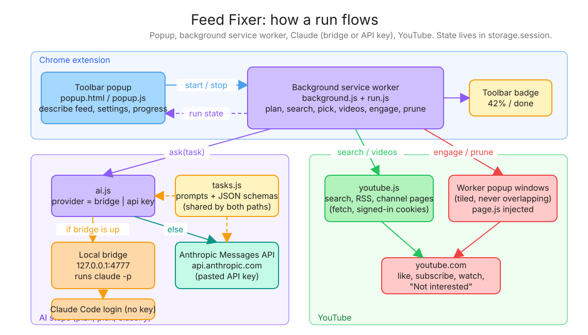

# Fix Your Feed

Describe the YouTube feed you want. Claude finds 10-25 creators in that niche, and the extension trains your recommendations toward them. It likes their latest videos, subscribes, watches a little of each, and marks off-niche videos on your home feed "Not interested".

Click the toolbar icon and a popup opens. Type a description, press **Fix my feed**, and close the popup if you like. The run continues in the background and the toolbar badge shows progress.

## Which AI it uses

The extension needs Claude for three small steps (planning searches, picking creators, flagging off-niche videos). It picks the first of these that works:

1. **Claude Code login.** If the local bridge is running, the extension uses your existing Claude Code login. No API key needed.
2. **Anthropic API key.** If no bridge is found, the popup asks you to paste an API key from [platform.claude.com/settings/keys](https://platform.claude.com/settings/keys). The key is stored in the extension's local storage and sent only to `api.anthropic.com`.

Both paths use the same prompts and JSON schemas in `extension/tasks.js`.

## Setup

1. Load the extension. Open `chrome://extensions`, turn on Developer mode, click **Load unpacked**, and pick the `extension/` folder.
2. Make sure you're signed in to YouTube in that Chrome profile.
3. Optional, for the Claude Code path: install the bridge as a login service (needs Node 20+ and `claude` on your PATH, logged in):

   ```sh
   scripts/install-bridge.sh            # starts now and at every login; logs in ~/Library/Logs/feed-bridge.log
   scripts/install-bridge.sh uninstall  # removes it
   ```

   Or run it in the foreground with `npm run bridge`. If you switch Node versions with nvm, rerun the install script.

4. Click the toolbar icon. If the popup says no AI is connected, paste an API key. Then describe your feed and press **Fix my feed**.

## Architecture



The editable source is [`docs/architecture.excalidraw`](docs/architecture.excalidraw). Open it at [excalidraw.com](https://excalidraw.com) to change it.

```mermaid
flowchart LR
  subgraph ext[Chrome extension]
    popup[Toolbar popup<br/>popup.js] -- start / stop --> sw[Background service worker<br/>background.js + run.js]
    sw -. run state via storage.session .-> popup
    sw --> badge[Toolbar badge]
  end
  subgraph ai[AI steps: plan, pick, classify]
    sw -- ask(task) --> prov[ai.js<br/>provider = bridge or API key]
    tasks[tasks.js<br/>prompts + schemas] -.-> prov
    prov -- bridge up --> bridge[Local bridge :4777<br/>runs claude -p]
    prov -- else --> api[Anthropic Messages API]
    bridge --> cc[Claude Code login]
  end
  subgraph yt[YouTube]
    sw -- search / videos --> ytjs[youtube.js<br/>search, RSS, channel pages]
    sw -- engage / prune --> workers[Worker popup windows<br/>page.js injected]
    ytjs --> ytcom[youtube.com]
    workers --> ytcom
  end
```

## What a run does

1. **Plan.** Claude turns your description into a one-line niche, a list of things to avoid, and 10 YouTube search queries.
2. **Search.** Each query runs twice on YouTube (video results and channel results). The top 60 channels get their recent upload titles pulled from RSS.
3. **Pick.** Claude ranks those real channels and picks your creator count. It can only choose from what search returned, so it can't invent a channel.
4. **Videos.** Pulls each creator's latest long-form uploads from their Videos tab (no Shorts).
5. **Engage.** Opens small popup windows (3 by default) tiled across the screen that each work through the queue. Every video gets liked. The first video per creator also gets a subscribe, and the latest N per creator get watched muted for a few seconds so they land in your watch history.
6. **Prune.** Loads your home feed, has Claude flag videos that clearly don't fit, and clicks "Not interested" on each one.

Runs are paced to a target duration (20 minutes by default). Videos are spread evenly across it with random gaps, so it looks less like a bot. The popup warns you if your settings can't fit in the target.

## Settings

Open **Settings** inside the popup.

| Setting | Default | Notes |
| --- | --- | --- |
| Creators | 15 | 5-25 |
| Videos per creator | 10 | |
| Watch latest N per creator | 3 | Watch history is the strongest signal, but it costs the most time |
| Seconds watched each | 20 | |
| Parallel windows | 3 | More only matters if the target is too short for the work |
| Target minutes | 20 | How long the run is spread over |

The bridge uses `sonnet` by default. Set `FEED_MODEL=haiku npm run bridge` for faster, cheaper calls, or `PORT=...` to move it off 4777 (and change `BRIDGE` in `extension/ai.js` to match). The API-key path uses `claude-sonnet-5-5`.

## Development

```sh
npm run check   # syntax-checks every file, validates the prompt schemas, smoke-tests the bridge with a fake claude
npm run smoke   # loads the extension in a throwaway headless Chrome, prints the popup state, writes popup.png
```

## Caveats

- It drives YouTube's real UI, so a YouTube redesign can break the selectors in `extension/page.js`. They're English-only ("Subscribe", "Not interested").
- Even spread over 20 minutes, 150 likes in one sitting is more than most people do. A longer target, fewer creators, or more watching and less liking is gentler on your account.
- Chrome may stop the background service worker if it stays idle. The run writes its state every second while active, which keeps the worker alive. If Chrome restarts it anyway, the popup shows the run as failed and the worker windows close.
- The bridge listens only on 127.0.0.1, requires the extension's `x-feed-fixer` header, refuses web-page origins and foreign Host headers, and runs Claude with all tools disabled.
